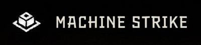
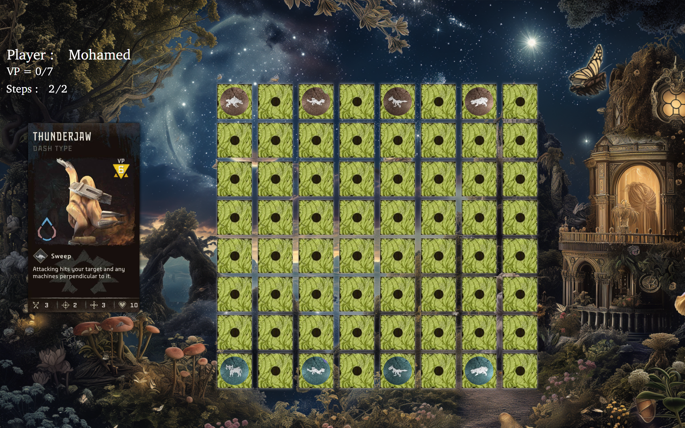

# Machine Strike Game

## Description

Machine Strike est un jeu de stratégie où les joueurs s'affrontent avec leur pièces avec des capacités et des pouvoirs spécifiques. Ce projet a été développé par : 
- Mohamed AKADDAR

## Pourquoi ce projet a été réalisé ?

Ce projet a été réalisé dans le but d'approfondir mes connaissances en programmation orientée objet et en développement de jeux vidéo. Il m'a permis de mettre en pratique des concepts tels que la gestion des événements, la manipulation des images et l'implémentation de la logique de jeu.
Java & JavaFX & XML ont été les technologies principales utilisées pour ce projet, offrant une expérience de développement riche et interactive.
---

## Table des Matières
- [Fonctionnalités réalisées](#fonctionnalités-réalisées)
- [Fonctionnalités restantes](#Fonctionnalités-restantes)
- [Manuel Lancer jeu](#manuel-lancer-jeu)
- [Répartition des Tâches](#répartition-des-tâches)
- [Classes](#classes)
- [Captures d'Écran](#capture-décran)
- [Contribution](#contribution)
- [Remerciements](#remerciements)

## Manuel Lancer jeu
2. `Avec IntelliJ` : Ouvrez le projet, build puis run ✅

## Classes (Business logic)
- `Tile` : Représente le terrain et la gestion de son image.
- `Piece` : Représente la pièce dans le jeu et la gestion de son image.
- `PieceProperties` : Représente les propriétés de la pièce (MouvementRange, power ...)
- `Player` : Représente le joueur ses caractéristiques et sa liste de pièces.
- `MachineStrikeController` : le controlleur qui gère toutes les actions qui se déroulent en jeu, clic, mouseEntred,...
- `MachineStrikeMain` : Le programme principal qui lance le jeu.

## Fonctionnalités Réalisées
- Création du plateau 
- Création et gestion 
- - Terrain (Classe - Tile)
- - Pièces (Classe - Piece et ses propriétés dans la classe PieceProperties.)
- - Joueurs (Classe - Player)
- Lancement de la partie : 
- - Déplacer - Attaquer.
- - Détection de zones d'attaques (Distance Manhattan).
- - Affichage des caractéristique de la pièce quand la souris est dessus.
- Gestion des points : 
- - L'incrémentation de VP de joueur quand sa pièce attaque.
- - Changement de tour après deux déplacements ou attaques.
- - Calculer et afficher combien de mouvement restantes.
- Gestion de la fin de la partie : 
- - Déclarer le gagnat avec son nombre
- - Proposer aux joueurs de rejouer (PlayAgain) ou quitter (Quitter)

## Fonctionnalités restantes
- Intelligence artificielle pour les adversaires.
- Mode multijoueur en ligne (mettre le plateau en serveur).

## Capture d'Écran
- Début de partie ! 🤩

- Fin de partie ! - un gagnant 🏆 

Pour toute question ou suggestion, n'hésitez pas à nous contacter l'un des développeurs : 
- [mohamed.akaddar@ecole.ensicaen.fr](mailto:mohamed.akaddar@ecole.ensicaen.fr)
