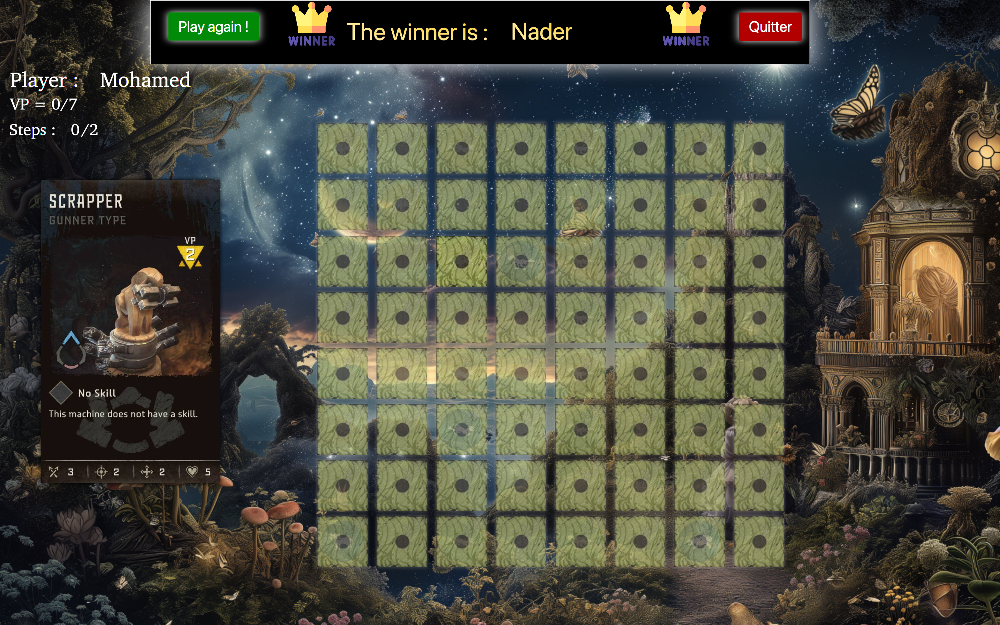

# Machine Strike Game

## Description

Machine Strike est un jeu de stratégie où les joueurs s'affrontent avec leur pièces avec des capacités et des pouvoirs spécifiques. Ce projet a été développé par : 
- Mohamed AKADDAR
- Nader HADJOUDJ

et encadré par : 
- M. FAYE Ndiaga

## Table des Matières
- [Fonctionnalités réalisées](#fonctionnalités-réalisées)
- [Fonctionnalités restantes](#Fonctionnalités-restantes)
- [Manuel Lancer jeu](#manuel-lancer-jeu)
- [Répartition des Tâches](#répartition-des-tâches)
- [Classes](#classes)
- [Captures d'Écran](#capture-décran)
- [Contribution](#contribution)
- [Remerciements](#remerciements)

## Manuel Lancer jeu 
- **2 possibilités**
1.  `Avec l'exécutable` : Accédez au 'build/distributions/MachineStrike*SNAPSHOT/bin/'. Ensuite, lancer l'exécutable. ✅

2. `Avec IntelliJ` : ouvrez le projet, build puis run ✅

## Répartition des Tâches
- **Nader HADJOUDJ** : 

- - Recherche sur les règles de jeu, et conception UML.
- - Implémenter fonctionnalités souris entrante - afficher image de la Piece.
- - Proposition de design de l'interface graphique.
- - Commit et push au git - Gitlab via IntelliJ.

- **Mohamed AKADDAR** : 
- - Développement de l'interface graphique.
- - Implémentation de fontionnalités de jeu en controlleur.
- - Conception UML.

## Classes
- `Tile` : Représente le terrain et la gestion de son image.
- `Piece` : Représente la pièce dans le jeu et la gestion de son image.
- `PieceProperties` : Représente les propriétés de la pièce (MouvementRange, power ...)
- `Player` : Représente le joueur ses caractéristiques et sa liste de pièces.
- `MachineStrikeController` : le controlleur qui gère toutes les actions qui se déroulent en jeu, clic, mouseEntred,...
- `MachineStrikeMain` : Le programme principal qui lance le jeu.

## Fonctionnalités Réalisées
- Création du plateau 
- Création et gestion 
- - Terrain (Classe - Tile)
- - Pièces (Classe - Piece et ses propriétés dans la classe PieceProperties.)
- - Joueurs (Classe - Player)
- Lancement de la partie : 
- - Déplacer - Attaquer.
- - Détection de zones d'attaques (Distance Manhattan).
- - Affichage des caractéristique de la pièce quand la souris est dessus.
- Gestion des points : 
- - L'incrémentation de VP de joueur quand sa pièce attaque.
- - Changement de tour après deux déplacements ou attaques.
- - Calculer et afficher combien de mouvement restantes.
- Gestion de la fin de la partie : 
- - Déclarer le gagnat avec son nombre
- - Proposer aux joueurs de rejouer (PlayAgain) ou quitter (Quitter)

## Fonctionnalités restantes
- Intelligence artificielle pour les adversaires.
- Mode multijoueur en ligne (mettre le plateau en serveur).

## Capture d'Écran
- Début de partie ! 🤩

- Fin de partie ! - un gagnant 🏆 

## Remerciements
Merci à M. FAYE Ndiaga de nous encadrer et nous mettre toujours dans le bon chemin, ainsi la proposition des indications pour résoudre nos problèmes rencontrés lors du développement du jeu. 
Un grand merci également aux profs M. Reynaud, M. Vernois et M. ROGER pour leur soutien et le suivi d'avancement, ainsi leurs retours.

---

Pour toute question ou suggestion, n'hésitez pas à nous contacter l'un des développeurs : 
- [mohamed.akaddar@ecole.ensicaen.fr](mailto:mohamed.akaddar@ecole.ensicaen.fr)
- [nader.hadjoudj@ecole.ensicaen.fr](mailto:nader.hadjoudj@ecole.ensicaen.fr ).
